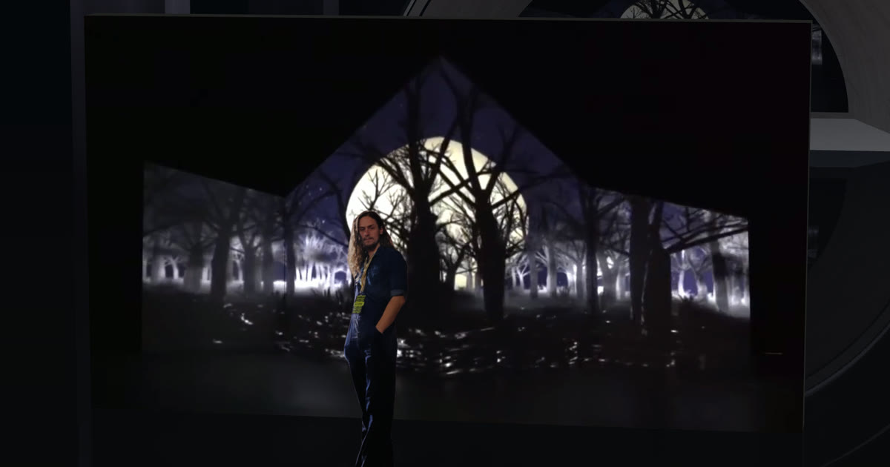

# bradschmitz.com

Portfolio site for Brad Schmitz, a creative technologist working with projection mapping, XR, and audio-reactive visuals. Live at **[bradschmitz.com](https://bradschmitz.com)**.



The whole site is a single 3D stage. Each page swaps what plays on the "screen": the demo reel, a project video, a procedural shader, or a spectrum visualizer that reacts to the track you're playing on the Music page.

## Stack

- [Next.js](https://nextjs.org/) (Pages Router) + React 19 + TypeScript
- [React Three Fiber](https://r3f.docs.pmnd.rs/) and [drei](https://drei.docs.pmnd.rs/) for the 3D scene, with custom GLSL materials
- Web Audio API (`AnalyserNode`) for the audio-reactive screen
- Sass modules for styling
- Deployed on Vercel

## How it fits together

| Path                                                                         | What it does                                                                                                     |
| ---------------------------------------------------------------------------- | ---------------------------------------------------------------------------------------------------------------- |
| [src/components/3D/](src/components/3D/)                                     | The persistent scene: backdrop, screen, pillars, ground reflections, camera rig, and the shader materials        |
| [src/hooks/useGetRouterSceneProps.ts](src/hooks/useGetRouterSceneProps.ts)   | Maps each route to what the scene shows (media, background variant, camera mode)                                 |
| [src/context/SceneVideoContext.tsx](src/context/SceneVideoContext.tsx)       | Lets a page override the screen's media, e.g. when you pick a project                                            |
| [src/context/AudioSpectrumContext.tsx](src/context/AudioSpectrumContext.tsx) | Shares live frequency data from the music player with the screen shader                                          |
| [src/components/Showcase/](src/components/Showcase/)                         | The project carousel and detail panel used by Code, Visuals, and Music; selection is deep-linked via `?project=` |
| [src/components/ScreenOverlay/](src/components/ScreenOverlay/)               | Lays text out so it reads as if it's on the screen (About, Connect)                                              |
| [src/components/SEO.tsx](src/components/SEO.tsx)                             | Per-page title, description, canonical URL, Open Graph tags, and JSON-LD                                         |

The `<Canvas>` lives in the shared layout, so the scene stays mounted while you navigate and transitions between routes instead of reloading.

## Running locally

```bash
npm install
npm run dev
```

Then open [http://localhost:3000](http://localhost:3000).

Other scripts: `npm run build`, `npm run start`, `npm run lint`.

## Media

Videos, audio, and images live under `public/branding/`. Large files are served directly from there, so keep new videos compressed (H.264 with `-movflags +faststart`).
